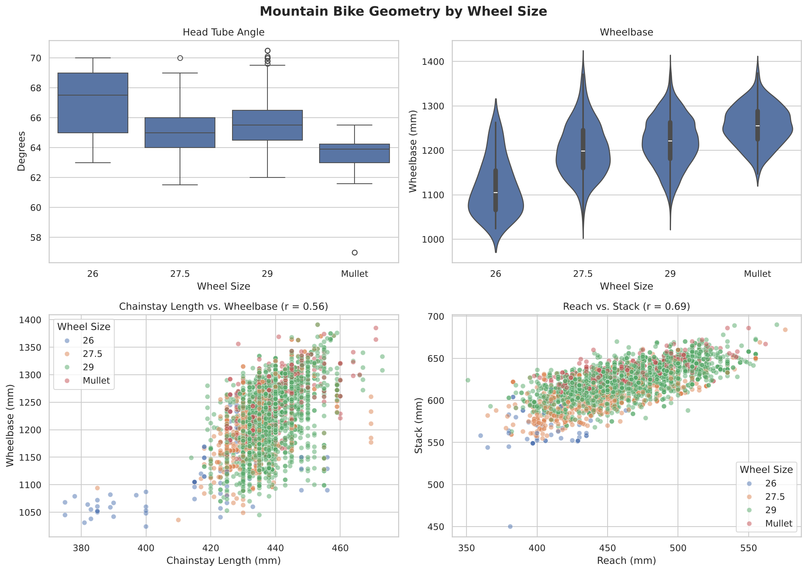

# Mountain Bike Geometry Analysis

How do mountain bike geometry measurements relate to one another, and how much of that variation does wheel size explain? This project examines head tube angle, wheelbase, reach, stack, chainstay length, and rear suspension travel across 26", 27.5", 29", and Mullet (29" front / 27.5" rear) mountain bikes, using geometry data from [MTB-News](https://geometrics.mtb-news.de/).

**Questions explored**
1. How does geometry differ across wheel configurations?
2. How strongly are the individual measurements related to each other?
3. Once those relationships are accounted for, does wheel size still matter?

## Data
- **Source:** MTB-News bike geometry database (via [dorianprill/dataset-bicycle-geometry](https://github.com/dorianprill/dataset-bicycle-geometry))
- **Size:** 6,529 raw records, 3,579 after filtering to non-motorized mountain bikes in the four wheel sizes, and 3,436 after removing missing or physically unrealistic measurements
- Each record is one frame size of one bike model, so a single bike can appear more than once.

## Methods
Python (pandas, Matplotlib, Seaborn): filtering, numeric conversion, range-based cleaning, grouped summary statistics, box/violin/scatter plots, correlation, and multiple linear regression (statsmodels) with standard errors clustered by bike.

## Key findings
- **Uneven groups:** 29" bikes dominate the data (2,431 records) and 26" bikes are the fewest (71), so 26" comparisons are less reliable.
- **Head tube angle:** 26" bikes are the steepest (median 67.5°). 29" (65.5°) and Mullet (63.9°) bikes are slacker.
- **Wheelbase:** Larger wheel configurations tend to be longer, and Mullet bikes have the longest median (1,255 mm vs. 1,105 mm for 26").
- **Relationships:** Chainstay length and wheelbase are positively correlated (r = 0.56), as are reach and stack (r = 0.69).
- **Regression:** A multiple linear regression predicting wheelbase from reach, stack, chainstay length, head tube angle, and wheel size explains most of the variation (R² = 0.969). Adding wheel size raises R² by only about 0.001. Compared with 29" bikes and holding the other measurements constant, Mullet bikes show no meaningful wheelbase difference (+0.4 mm, p = 0.78), and the 26" and 27.5" differences are small (+8 mm and +5 mm). The longer wheelbases seen in the plots are mostly explained by the other geometry measurements, not wheel size itself.
- **Head tube angle is different:** Reach, stack, chainstay length, and wheel size explain only about a third of the variation in head tube angle (R² = 0.31). Adding rear suspension travel, a rough proxy for intended use, doubles R² to 0.65 and shrinks the Mullet vs. 29" head-angle gap from -1.2° to -0.4°. Head angle appears to follow how the bike is meant to be ridden more than its wheel size.
- **Takeaway:** Geometry measurements move together as a system. Wheel groups overlap heavily, and once the other measurements are accounted for, wheel size explains very little additional variation in wheelbase.

## Limitations
- Wheelbase is partly determined by the other measurements by construction, so the high R² is expected. The regression is descriptive, not a predictive tool.
- Group sizes are unequal, and these are descriptive comparisons, not causal claims.
- Cleaning thresholds were chosen by judgment (see `mtb_geometry_analysis.py`).
- Records are frame sizes, not unique bikes.
- Rear suspension travel is missing for many bikes (e.g., hardtails), so the travel analyses cover fewer records (2,780 records, 501 bikes). Travel is only a rough proxy for intended use.
- Wheelbase is left out of the head tube angle models because it is partly determined by head angle.

## Run it
```bash
pip install pandas matplotlib seaborn statsmodels
python mtb_geometry_analysis.py
```
Charts are saved to `figures/`.


